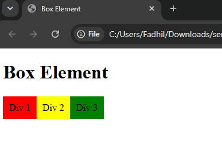
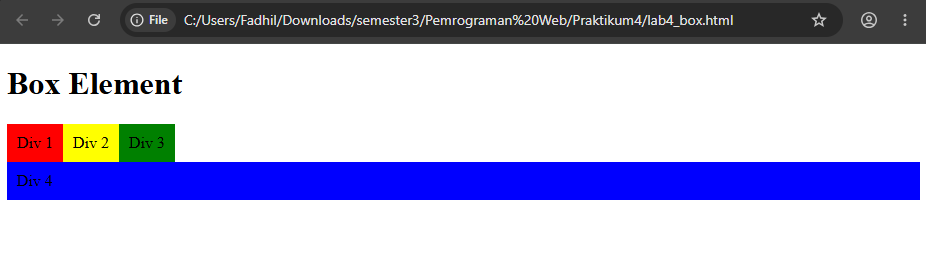
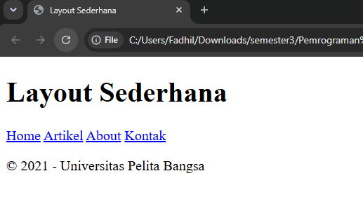
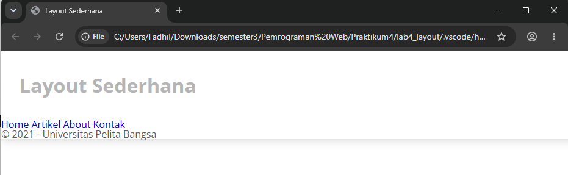
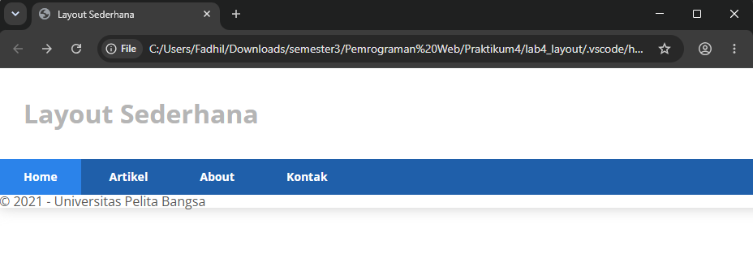
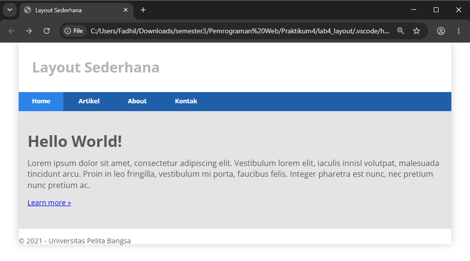
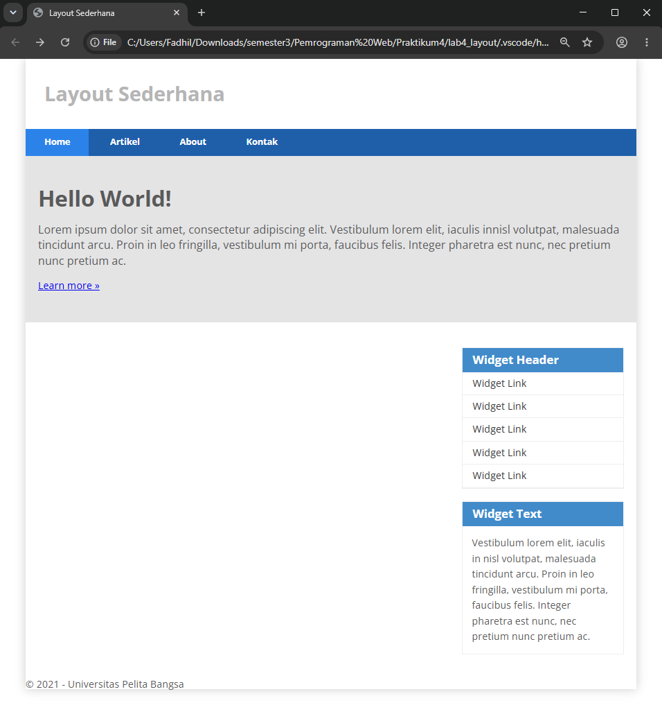
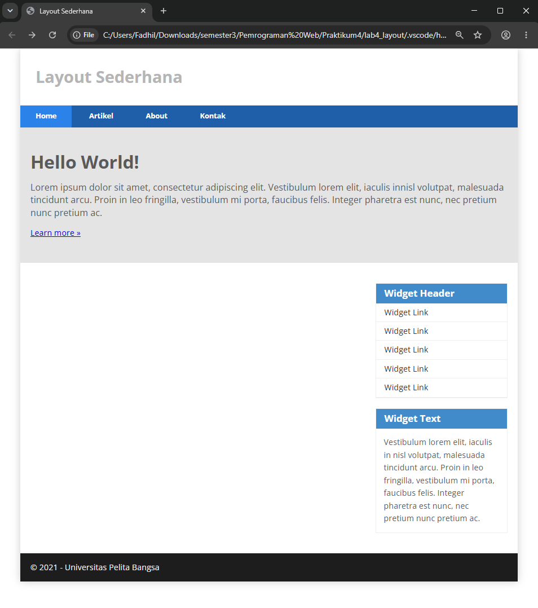
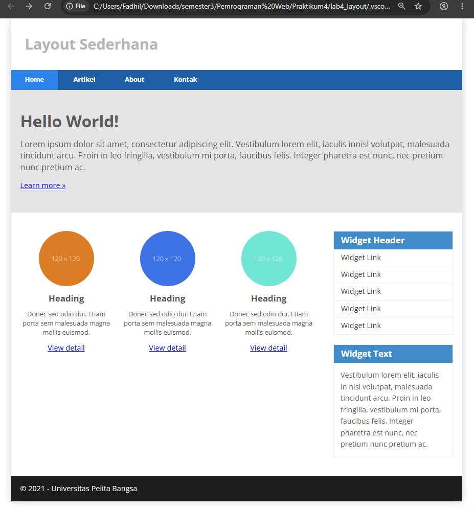
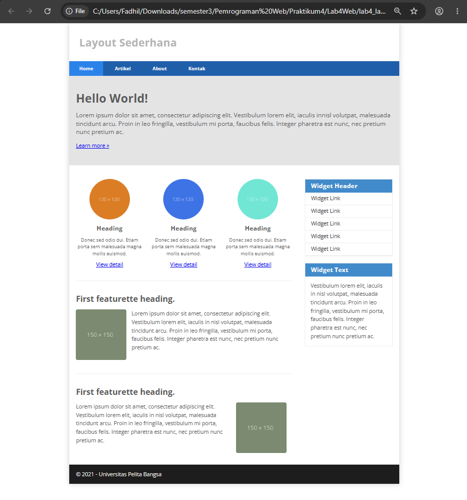

# Praktikum 4 - CSS Layout

## Nama: Fadhil Syafiq Abdullah  
## NIM: 312510161  
## Mata Kuliah: Pemrograman Web  

### 1. Membuat Dokumen HTML

pada langkah pertama, dibuat dokumen HTML dengan nama lab4_box.HTML. Dokumen ini menggunakan struktur dasar HTML yang terdiri dari `<DOCTYPE html>`, `<head>`, dan `<body>`. Pada bagian body ditambahkan elemen `<header>` dengan judul Box Element. 

Code: 

.png)

### 2. Membuat Box Element

Selanjutnya, ditambahkan tiga elemen `
` di dalam elemen `<selection>`, yaitu Div1, Div2, Div3. Setiap elemen menggunakan class yang berbeda agar dapat diatur secara terpisah melalui CSS. 

Code:

.png) 

Output:

 

Hasilnya menampilkan tiga elemen div sebagai kotak pada halaman web. Pada tahap ini, mengikuti susunan normal HTML sebelum properti float diterapkan. 

### 3. Mengatur CSS Float Property

Pada tahap ini, ditambahkan CSS menggunakan properti float: left agar ketiga elemen div dapat tersusun secara horizontal. Properti padding: 10px digunakan untuk memberikan ruang di dalam kotak, sedangkan warna latar merah, kuning, dan hijau digunakan untuk membedakan setiap elemen. 

Code:

.png) 

Output:

 

Hasilnya menunjukkan ketiga kotak tersusun berdampingan dari kiri ke kanan menggunakan properti float. 

### 4. Mengatur Clearfix Element
### 4.1 Menambahkan Elemen Div 4

Elemen div keempat ditambahkan setelah Div 3 dengan menggunakan class div4. Penambahan ini dilakukan untuk mengamati posisi elemen setelah elemen sebelumnya menggunakan properti float. 

Code:

.png) 

### 4.2 Mengatur Properti Clear

Pada class .div4, ditambahkan properti background-color: blue, clear: left dan float: none. Properti clear: left digunakan agar elemen tidak berada di samping elemen yang mengambang ke kiri. 

Code:

.png) 

Output:

 

Hasilnya menunjukkan Div 4 berada di bawah elemen yang menggunakan float ke kiri. Properti clear juga dapat diuji menggunakan nilai both dan right untuk mengamati perubahan tata letaknya. 

### 5 Membuat Layout Sederhana
### 5.1 Membuat Dokumen HTML dan CSS

Pada tahap ini, dibuat folder `lab4_layout` yang berisi file `home.html` dan `style.css`. File HTML digunakan untuk membangun struktur halaman, sedangkan file CSS digunakan untuk menagtur tampilannya. Kedua file dihubungkan menggunakan elemen `<link rel="stylesheet" href="style.css">` 

Code:

.png) 

### 5.2 Membuat Kerangka Layout

Selanjutnya, ditambahkan elemen semantik HTML seperti `<header>`, `<nav>`, `<section>`, `<aside>`, dan `<footer>`. Elemen-elemen tersebut digunakan untuk membagi halaman menjadi bagian header, navigasi, hero panel, konten utama, sidebar, dan footer. 

Code:

.png) 

### 5.3 Mengatur CSS Dasar dan Header

File style.css diisi dengan pengaturan dasar, seperti reset margin dan padding, jenis huruf, ukuran container, warna teks, serta tampilan header. Container diatur menggunakan lebar 980 piksel dan margin: 0 auto agar berada di tengah halaman. 

Code:

.png) 

Output:

 

Hasilnya menampilkan container dan header dengan judul Layout Sederhana. Pada tahap ini, struktur dasar dan tampilan header telah diterapkan. 

### 6. Membuat Navigasi

Navigasi diatur menggunakan elemen nav dengan warna latar biru. Tautan navigasi diberi padding, warna teks putih, dan `display: inline-block` agar tersusun dalam satu baris. Selector nav `a.active` dan `nav a:hover` digunakan untuk memberikan warna berbeda pada menu aktif atau ketika penunjuk diarahkan ke tautan. 

Code:

.png) 

Output:

 

Hasilnya menampilkan Menu Home, Artikel, About, dan Kontak dalam satu baris dengan latar biru. Menu aktif atau menu yang sedang ditunjuk memiliki warna latar berbeda. 

### 7. Membuat Hero Panel
### 7.1 Menambahkan HTML Hero Panel

Pada tahap ini, ditambahkan elemen `<section id="hero">` yang berisi judul Hello World!, paragraf deskripsi, dan tautan Learn more. Hero panel berfungsi sebagai bagian pengenalan utama pada halaman web. 

Code:

.png) 

### 7.2 Mengatur CSS Hero Panel

CSS hero panel ditambahkan untuk mengatur warna latar abu-abu, padding, jarak bawah, ukuran judul, dan tinggi baris paragraf. Pengaturan tersebut membuat tampilan hero panel lebih rapi dan nyaman dibaca. 

Code:

.png) 

Output:

 

### 8. Mengatur Main Content dan Sidebar

Pada tahap ini, CSS float digunakan untuk mengatur posisi konten utama dan sidebar. Elemen #main diberi lebar 640 piksel dan padding 20 piksel, sedangkan `#sidebar` diberi lebar 260 piksel dan padding 20 piksel. Keduanya menggunakan `float: left` agar tersusun berdampingan. 

Code:

.png) 

### 9. Membuat Sidebar Widget
### 9.1 Menambahkan HTML Sidebar Widget

Di dalam elemen `<aside id="sidebar">` ditambahkan dua widget. Widget pertama berisi judul Widget Header dan daftar tautan, sedangkan widget kedua berisi judul Widget Text dan paragraf deskripsi. 

Code:

.png) 

### 9.2 Mengatur CSS Sidebar Widget

CSS ditambahkan untuk mengatur garis tepi widget, jarak antarwidget, warna latar judul, warna teks, daftar tautan, dan paragraf. Efek `:hover` digunakan untuk mengubah warna latar tautan ketika penunjuk diarahkan ke tautan tersebut. 

Code:

.png) 

Output:

 

Hasilnya menampilkan widget pada sidebar yang terdiri dari daftar tautan dan kotak teks. Setiap widget memiliki judul berlatar biru dan isi yang tersusun rapi. 

### 10. Mengatur Footer

Pada tahap ini, footer diatur menggunakan CSS dengan warna latar gelap, padding 20 piksel, dan warna teks terang. Properti clear: both digunakan agar footer berada di bawah elemen yang menggunakan float. 

Code:

.png) 

Output:

 

Hasilnya menampilkan footer pada bagian bawah halaman dengan latar gelap dan teks berwarna terang. 

### 11. Menambahkan Elemen Lain pada Main Content
### 11.1 Menambahkan HTML Kotak Konten

Di dalam elemen `#main`, ditambahkan tiga kotak konten menggunakan `class .box`. Setiap kotak berisi gambar, judul Heading, paragraf deskripsi, dan tautan View detail. Gambar menggunakan alamat gambar contoh dari dummyimage.com. 

Code:

.png) 

### 11.2 Mengatur CSS Kotak Konten

CSS .box digunakan untuk mengatur posisi, lebar, padding, dan perataan teks. Properti `float: left` membuat kotak tersusun berdampingan, sedangkan `box-sizing: border-box` membantu mengatur perhitungan lebar elemen. `Class .image-circle` menggunakan `border-radius: 50%` untuk membuat gambar berbentuk bulat. 

Code:

.png) 

### 11.3 Mengatur Row dan Clearfix

Selanjutnya, `class .row` diatur menggunakan margin dan `box-sizing`. Pseudo-element `:before` dan `:after`digunakan untuk membantu mengatur elemen float. Properti `clear: both` pada `.row:after` dan .entry:after membantu membersihkan float setelah konten. 

Code:

.png) 

Output:

 

Hasilnya menampilkan tiga kotak konten yang tersusun sejajar. Setiap kotak berisi gambar berbentuk bulat, judul, deskripsi singkat, dan tautan View detail. 

### 12. Menambahkan Content Artikel
### 12.1 Menambahkan HTML Content Artikel

Pada tahap ini, ditambahkan dua elemen `<article class="entry">` yang berisi judul, gambar, dan paragraf. Elemen `
` digunakan sebagai garis pemisah antarartikel. Pada artikel kedua, gambar menggunakan class right-img agar posisinya berada di sebelah kanan. 

Code:

.png) 

### 12.2 Mengatur CSS Content Artikel

CSS .divider digunakan untuk mengatur garis pemisah dan jarak vertikal. Class .entry mengatur jarak antarartikel, sedangkan CSS judul dan paragraf mengatur jarak serta tinggi baris. Gambar artikel menggunakan `float: left`, sudut membulat, dan margin kanan. `Class .right-img` digunakan untuk menempatkan gambar di sisi kanan. 

Code:

.png) 

Output:

 

Hasilnya menampilkan dua bagian artikel dipisahkan garis horizontal. Gambar artikel ini pertama berada di sebelah kiri teks, sedangkan gambar artikel kedua berada di sebelah kanan teks. 